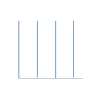

## Hi there 👋

<!--
**wang2000star/wang2000star** is a ✨ _special_ ✨ repository because its `README.md` (this file) appears on your GitHub profile.

Here are some ideas to get you started:

- 🔭 I’m currently working on ...
- 🌱 I’m currently learning ...
- 👯 I’m looking to collaborate on ...
- 🤔 I’m looking for help with ...
- 💬 Ask me about ...
- 📫 How to reach me: ...
- 😄 Pronouns: ...
- ⚡ Fun fact: ...
-->

### 编程语言 <picture style="margin-right: 10px;"></picture>

### Github 贡献图 <picture style="margin-right: 10px;"></picture>

<!doctype html>
<html lang="zh-CN">
<head>
<meta charset="utf-8">
<meta name="viewport" content="width=device-width, initial-scale=1">
<meta name="theme-color" content="#05070d">
<meta name="description" content="实时显示 UTC、洛杉矶、AOE、北京等世界主要城市时间的在线世界时钟，自动处理夏令时，支持添加任意 IANA 时区。">
<title>World Clock · 世界时钟</title>

</head>
<body>
  

    <header class="topbar">
      

        
          <svg viewBox="0 0 24 24" fill="none" stroke="currentColor" stroke-width="1.35" stroke-linecap="round" stroke-linejoin="round">
            <circle cx="12" cy="12" r="8.7"></circle>
            <path d="M3.4 12h17.2M12 3.3c2.4 2.35 3.65 5.25 3.65 8.7S14.4 18.35 12 20.7c-2.4-2.35-3.65-5.25-3.65-8.7S9.6 5.65 12 3.3Z"></path>
            <path d="M5.2 6.8c1.8 1.05 4.1 1.65 6.8 1.65s5-.6 6.8-1.65M5.2 17.2c1.8-1.05 4.1-1.65 6.8-1.65s5 .6 6.8 1.65"></path>
          </svg>
        
        
          <strong>World Clock</strong>
          <small>世界时钟 · Live</small>
        
      

      

        

          <button type="button" data-format="24" class="active" aria-pressed="true">24H</button>
          <button type="button" data-format="12" aria-pressed="false">12H</button>
        

        <button type="button" class="btn-add" id="open-add" aria-label="添加城市">
          <svg viewBox="0 0 24 24" fill="none" stroke="currentColor" stroke-width="2" stroke-linecap="round" aria-hidden="true">
            <path d="M12 5v14M5 12h14"></path>
          </svg>
          添加城市
        </button>
      

    </header>

    <main>
      <section class="hero" aria-label="本地时间">
        

          

            
            本地时间
            /
            <b id="local-zone-name">Local</b>
          

          

            00:00
            :00
            AM
          

          

            —
            
            —
          

          
全球 <b id="zone-count">8</b> 个时区，实时同步 · 自动处理夏令时

        

        

          <svg class="globe-svg" viewBox="0 0 480 480" fill="none">
            <defs>
              <radialGradient id="sphereGrad" cx="33%" cy="27%" r="78%">
                <stop offset="0%" stop-color="#20385e" stop-opacity="0.92"></stop>
                <stop offset="46%" stop-color="#0f1c33" stop-opacity="0.96"></stop>
                <stop offset="100%" stop-color="#060a13"></stop>
              </radialGradient>
              <radialGradient id="sphereGloss" cx="30%" cy="22%" r="58%">
                <stop offset="0%" stop-color="#b7dcff" stop-opacity="0.16"></stop>
                <stop offset="58%" stop-color="#8fb7ff" stop-opacity="0.035"></stop>
                <stop offset="100%" stop-color="#8fb7ff" stop-opacity="0"></stop>
              </radialGradient>
              <linearGradient id="rimGrad" x1="90" y1="80" x2="390" y2="410" gradientUnits="userSpaceOnUse">
                <stop offset="0%" stop-color="#b7e2ff" stop-opacity="0.56"></stop>
                <stop offset="48%" stop-color="#7789ff" stop-opacity="0.10"></stop>
                <stop offset="100%" stop-color="#c4b5fd" stop-opacity="0.38"></stop>
              </linearGradient>
              <linearGradient id="arcGrad" x1="140" y1="150" x2="380" y2="330" gradientUnits="userSpaceOnUse">
                <stop offset="0%" stop-color="#7dd3fc" stop-opacity="0.08"></stop>
                <stop offset="50%" stop-color="#7dd3fc" stop-opacity="0.46"></stop>
                <stop offset="100%" stop-color="#c4b5fd" stop-opacity="0.12"></stop>
              </linearGradient>
              <clipPath id="globeClip">
                <circle cx="240" cy="240" r="168"></circle>
              </clipPath>
            </defs>

            <circle cx="240" cy="240" r="216" stroke="#7c8cff" stroke-opacity="0.10" stroke-dasharray="1 9"></circle>
            <circle cx="240" cy="240" r="195" stroke="#a5b4fc" stroke-opacity="0.055"></circle>

            <g class="globe-sphere">
              <circle cx="240" cy="240" r="168" fill="url(#sphereGrad)" stroke="url(#rimGrad)" stroke-width="1.2"></circle>
              <g clip-path="url(#globeClip)">
                <circle cx="240" cy="240" r="168" fill="url(#sphereGloss)"></circle>
                <g stroke="#a5cbff" stroke-opacity="0.12" stroke-width="0.85">
                  <ellipse cx="240" cy="240" rx="56" ry="168"></ellipse>
                  <ellipse cx="240" cy="240" rx="112" ry="168"></ellipse>
                  <ellipse cx="240" cy="240" rx="152" ry="168"></ellipse>
                  <path d="M240 72v336"></path>
                  <ellipse cx="240" cy="145" rx="159" ry="17"></ellipse>
                  <ellipse cx="240" cy="187" rx="167" ry="18"></ellipse>
                  <ellipse cx="240" cy="240" rx="168" ry="18"></ellipse>
                  <ellipse cx="240" cy="293" rx="167" ry="18"></ellipse>
                  <ellipse cx="240" cy="335" rx="159" ry="17"></ellipse>
                </g>
                <g stroke="url(#arcGrad)" stroke-width="1.05" stroke-linecap="round">
                  <path class="globe-arc" d="M150 235 Q230 124 250 185"></path>
                  <path class="globe-arc reverse" d="M250 185 Q305 128 350 215"></path>
                  <path class="globe-arc" d="M350 215 Q407 258 380 320"></path>
                  <path class="globe-arc reverse" d="M150 235 Q252 48 365 230"></path>
                  <path class="globe-arc" d="M205 215 Q178 270 215 315"></path>
                </g>
                <g fill="#8ccfff">
                  <circle cx="150" cy="235" r="2.1" fill-opacity="0.9"></circle>
                  <circle cx="205" cy="215" r="1.8" fill-opacity="0.75"></circle>
                  <circle cx="250" cy="185" r="1.8" fill-opacity="0.75"></circle>
                  <circle cx="305" cy="245" r="1.7" fill-opacity="0.65"></circle>
                  <circle cx="350" cy="215" r="2.1" fill-opacity="0.9"></circle>
                  <circle cx="365" cy="230" r="1.5" fill-opacity="0.55"></circle>
                  <circle cx="380" cy="320" r="2" fill-opacity="0.8"></circle>
                  <circle cx="215" cy="315" r="1.7" fill-opacity="0.65"></circle>
                </g>
                <g fill="#9ddcff">
                  <circle class="city-pulse" cx="150" cy="235" r="5" fill-opacity="0.15"></circle>
                  <circle class="city-pulse p2" cx="350" cy="215" r="5" fill-opacity="0.15"></circle>
                  <circle class="city-pulse p3" cx="380" cy="320" r="5" fill-opacity="0.15"></circle>
                </g>
                <g fill="#8ea4c4" font-family="-apple-system, BlinkMacSystemFont, Segoe UI, sans-serif" font-size="7.5" font-weight="600" letter-spacing="1.4">
                  <text x="142" y="228" text-anchor="end" fill-opacity="0.65">LAX</text>
                  <text x="242" y="177" text-anchor="end" fill-opacity="0.6">LON</text>
                  <text x="359" y="207" fill-opacity="0.7">BEI</text>
                  <text x="391" y="330" fill-opacity="0.65">SYD</text>
                </g>
              </g>
              <circle cx="240" cy="240" r="168" stroke="#dbeafe" stroke-opacity="0.045" stroke-width="7"></circle>
            </g>

            <g transform="rotate(-18 240 245)" opacity="0.75">
              <ellipse cx="240" cy="245" rx="226" ry="82" stroke="#8099c9" stroke-opacity="0.13" stroke-width="0.8" stroke-dasharray="2 9"></ellipse>
              <circle r="2.7" fill="#9ddcff" fill-opacity="0.9">
                <animateMotion dur="30s" repeatCount="indefinite" path="M 14 245 a 226 82 0 1 0 452 0 a 226 82 0 1 0 -452 0"></animateMotion>
              </circle>
              <circle r="1.5" fill="#c4b5fd" fill-opacity="0.8">
                <animateMotion dur="30s" begin="-15s" repeatCount="indefinite" path="M 14 245 a 226 82 0 1 0 452 0 a 226 82 0 1 0 -452 0"></animateMotion>
              </circle>
            </g>

            <g fill="#dbeafe">
              <circle cx="58" cy="118" r="1.1" opacity="0.35"></circle>
              <circle cx="422" cy="92" r="1.3" opacity="0.38"></circle>
              <circle cx="446" cy="204" r="0.9" opacity="0.28"></circle>
              <circle cx="43" cy="304" r="1.1" opacity="0.28"></circle>
              <circle cx="390" cy="438" r="0.9" opacity="0.26"></circle>
              <circle cx="102" cy="418" r="1.2" opacity="0.24"></circle>
              <circle cx="328" cy="40" r="0.8" opacity="0.32"></circle>
              <circle cx="462" cy="340" r="0.8" opacity="0.24"></circle>
            </g>
          </svg>

          

            
            UTC
            <strong id="hero-utc">00:00</strong>
          

        

      </section>

      <section class="section-head" aria-labelledby="world-clock-title">
        

          <h2 class="section-title" id="world-clock-title">世界时钟 8</h2>
          
卡片右上角 × 可移除城市 · 时间每秒刷新

        

        

          <i class="work-dot"></i>工作时段 · 当地工作日 9–18
          <i class="night-dot"></i>夜间
        

      </section>

      

      

        

          

            <svg viewBox="0 0 24 24" fill="none" stroke="currentColor" stroke-width="1.4" stroke-linecap="round">
              <circle cx="12" cy="12" r="8.5"></circle>
              <path d="M12 7.5V12l3 1.8"></path>
            </svg>
          

          <h2 class="empty-title">还没有添加城市</h2>
          
从全球 400 多个 IANA 时区中挑选城市，建立你的世界时钟。

          <button type="button" class="btn-ghost" id="reset-empty">恢复默认城市</button>
        

      

    </main>

    <footer class="site-foot">
      <i class="foot-dot"></i> 时间由设备时钟实时计算 · 基于 Intl API
      AOE = ANYWHERE ON EARTH · UTC−12
    </footer>
  

  

    

    

      

        

          
ADD A TIME ZONE

          <h2 class="modal-title" id="modal-title">添加城市</h2>
        

        <button type="button" class="icon-btn" id="close-modal" aria-label="关闭">
          <svg viewBox="0 0 24 24" fill="none" stroke="currentColor" stroke-width="2" stroke-linecap="round" aria-hidden="true">
            <path d="M6 6l12 12M18 6L6 18"></path>
          </svg>
        </button>
      

      

        <svg viewBox="0 0 24 24" fill="none" stroke="currentColor" stroke-width="1.7" stroke-linecap="round" aria-hidden="true">
          <circle cx="11" cy="11" r="6.7"></circle>
          <path d="M16 16l4.2 4.2"></path>
        </svg>
        <input type="search" id="zone-search" placeholder="搜索城市或时区，例如：东京、Europe/London" autocomplete="off" spellcheck="false" aria-label="搜索城市或时区">
      

      

        热门城市
        
      

      

    

  

  

</body>
</html>
