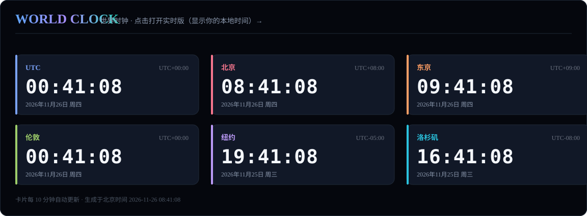

## Hi there 👋

<!--
**wang2000star/wang2000star** is a ✨ _special_ ✨ repository because its `README.md` (this file) appears on your GitHub profile.

Here are some ideas to get you started:

- 🔭 I’m currently working on ...
- 🌱 I’m currently learning ...
- 👯 I’m looking to collaborate on ...
- 🤔 I’m looking for help with ...
- 💬 Ask me about ...
- 📫 How to reach me: ...
- 😄 Pronouns: ...
- ⚡ Fun fact: ...
-->

### 编程语言 <picture style="margin-right: 10px;"></picture>

### Github 贡献图 <picture style="margin-right: 10px;"></picture>

### 🌍 世界时钟 <picture style="margin-right: 10px;"></picture>

卡片每 10 分钟自动更新；点击图片打开实时网页，会自动显示**你本机**的本地时间 ⏰

  
  

「手动刷新」会跳转到 Actions 页面，点右侧 **Run workflow** → **Run workflow** 即可立即更新时间。
